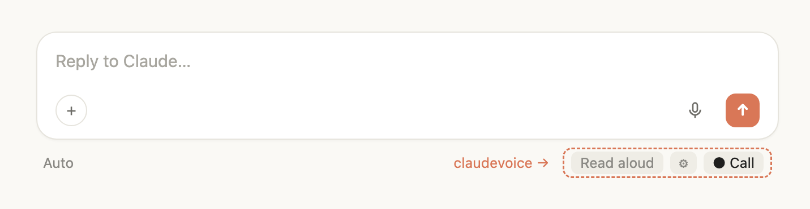
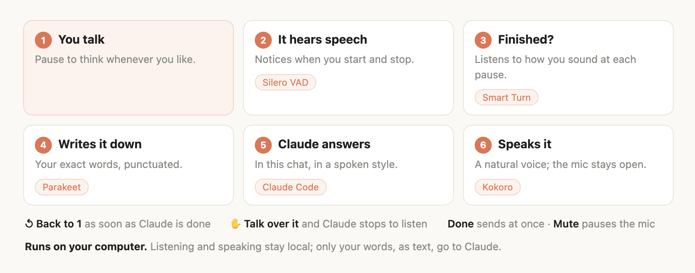
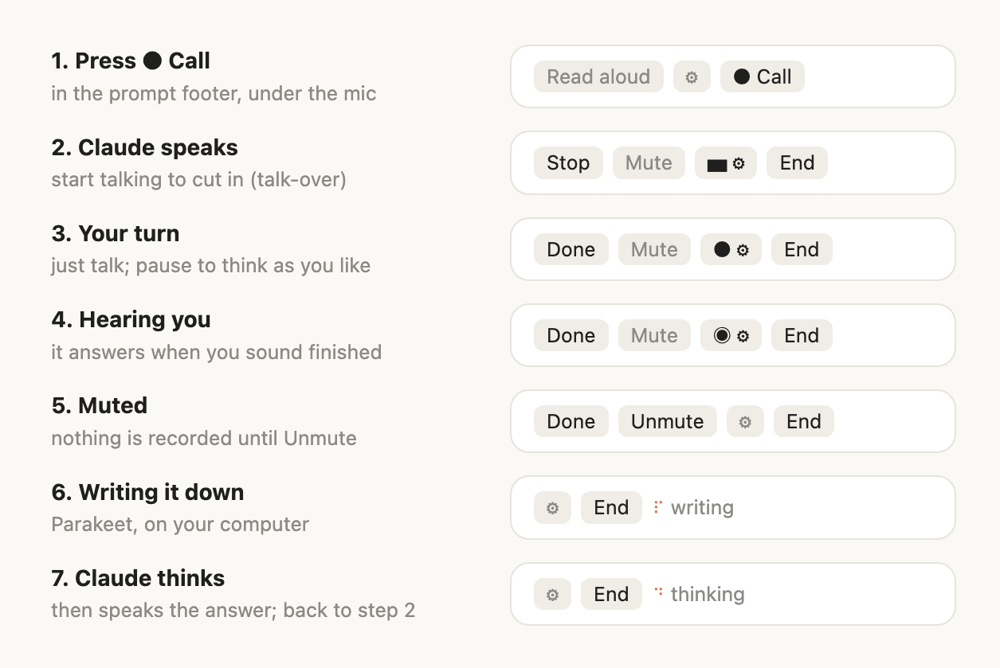
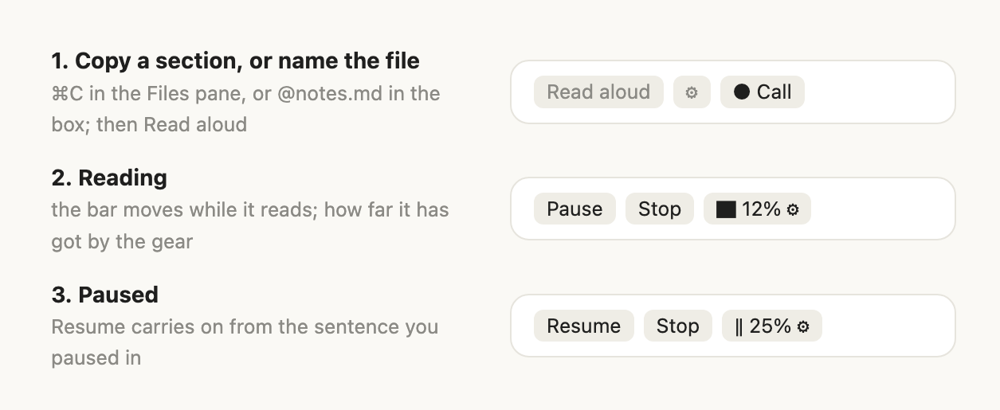
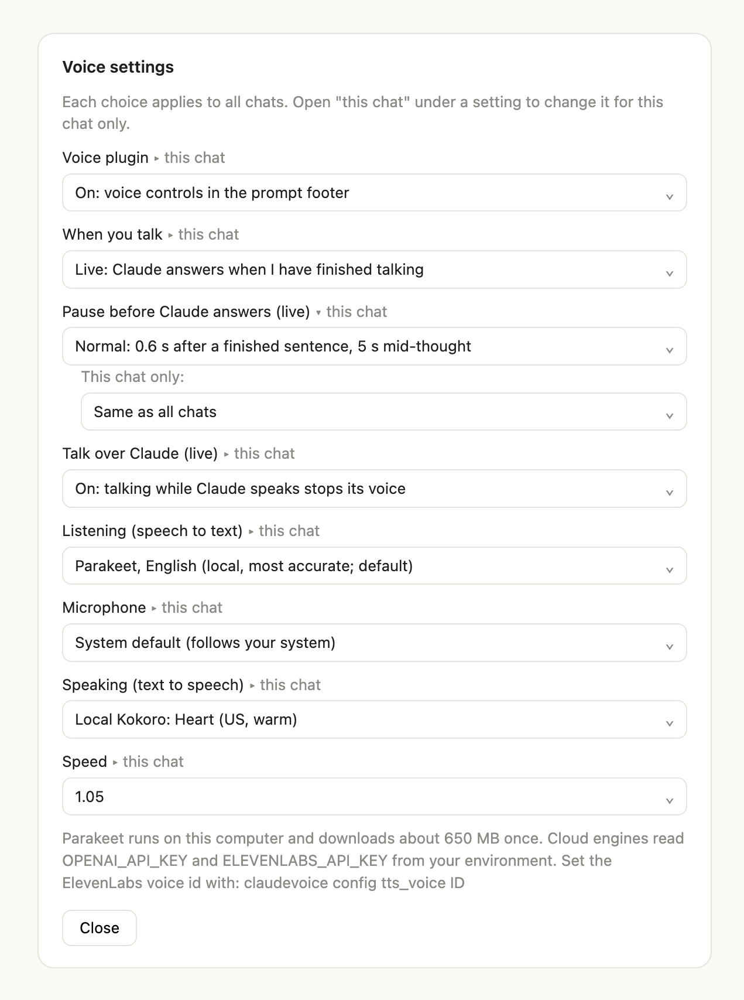

# claudevoice

**Talk with Claude Code, and hear it talk back.** A live, hands-free voice conversation right inside
your Claude Code chat: you speak, Claude answers out loud when you've finished, and you can cut in
any time. It reads your files aloud too. It all runs on your computer.

<p align="center">
  
</p>

- **Just talk.** Pause to think as long as you like; Claude answers when you sound finished.
- **Cut in.** Start talking while Claude speaks, and it stops to listen.
- **Read files aloud.** Copy part of a markdown, text or PDF file, or name the file, and press
  **Read aloud**. Pause and pick up where you left off.
- **Private and free.** Listening and speaking run on your computer, with no extra account or API key.

## Get started

1. **Install [uv](https://docs.astral.sh/uv/)**, once per computer:
   `curl -LsSf https://astral.sh/uv/install.sh | sh` ([Windows and Linux notes](#install-in-detail)).
2. **Add the plugin.** In the Claude Code desktop app: **+** next to the prompt, **Plugins**,
   **Add marketplace** `SinaJaf/claudevoice`, then **Add plugin**.
3. **Press ● Call** under the prompt box and start talking. The first call sets itself up, which
   takes a few minutes once.

## How it works

<p align="center">
  
</p>

## A call, step by step

The controls sit on the right of the prompt footer and change with the call. Only the buttons you
can use right now are shown. The gear doubles as the live indicator: a moving bar while Claude
speaks, a dot while it listens (◉ once it hears you), and a word while it starts, writes down what
you said, or thinks.

<p align="center">
  
</p>

- **Done** sends what you said right away, without waiting for the pause.
- **Mute** pauses the mic. Nothing is recorded while muted, and what you already said is kept.
- **Stop** cuts Claude's voice. Talking over it does the same.
- **End call** (**End** in the desktop app, where the footer is narrow) stops the mic and the voice.
  It never cancels work Claude is doing.
- **Read aloud** (outside a call) speaks the last reply once, or a file ([below](#reading-files-aloud)).
- Switch headphones, speakers or microphones whenever you like: the voice and the mic follow your
  system's current devices, even mid-turn.

How it knows you've finished: [Smart Turn](https://github.com/pipecat-ai/smart-turn) listens to how
you speak, not only to silence. So "so what I want is..." or an "um" keeps the turn yours, while a
finished sentence ends it after a short pause. A long pause ends it anyway, and **Done** ends it at once.

## Reading files aloud

**Read aloud** reads what you point it at, in this order:

1. **Text you've just copied.** In a file open in the app's Files pane, or a PDF in any other app,
   highlight a section, copy it (⌘C, or Ctrl+C), and press **Read aloud**. A copied file path
   reads that file. Something copied out of the chat itself is left alone.
2. **Text you've selected in the chat.** Highlight it and press **Read aloud**; no copying needed.
3. **A file named in the prompt box.** Type `@` and pick the file (`@notes.md`, `@report.pdf`),
   then press **Read aloud** to hear it from the start. `@notes.md#L40-80` reads just those lines.
   A path dragged into the box works too.
4. **Otherwise**, Claude's last reply.

<p align="center">
  
</p>

Why copy in the Files pane: the app tells plugins what you've highlighted in the chat, but not in
the Files pane, and not which file is open there.

While a file is being read, **Pause** keeps your place, **Resume** carries on from the sentence you
paused in, and **Stop** ends it. The gear shows how far it has got. **Call** steps aside while a
file is being read, to keep the footer short; **Stop** brings it back. If Claude starts talking or
you start a call, the reading pauses instead of being lost.

You can also type `/read notes.md`, or `/read report.pdf 12` to start at page 12 (for a text file,
the number is a line).

Markdown, plain text and PDF work. Headings, lists and tables are read as sentences, code blocks
are announced rather than spelled out, and a PDF's page numbers, running headers and footers are
skipped. A scanned PDF (pictures of pages) has no text to read.

---

## Settings



Open them with the **⚙** in the footer. Every choice applies to all chats; open **▸ this chat** under
a setting to choose a different value for the chat you're in, and **Same as all chats** to go back.

- **Voice plugin**: on, or off (off leaves only the gear, to turn it back on).
- **When you talk**: *Live* answers when you've finished; *Hold* waits for **Done**.
- **Pause before Claude answers**: Short, Normal, Long, then Long ×2 up to Long ×10 for long
  thinking pauses (Long ×10 waits 5 minutes of silence). A change applies even mid-turn.
- **Talk over Claude**: on with headphones; turn it off on speakers if Claude's own voice interrupts it.
- **Listening**: NVIDIA [Parakeet](https://huggingface.co/nvidia/parakeet-tdt-0.6b-v2) on your
  computer (default; English, or 25 European languages), the Mac's or Windows' own recognizer,
  Whisper (installed when you pick it), or OpenAI's cloud transcription.
- **Microphone**, **Speaking** (Kokoro voices, or OpenAI and ElevenLabs cloud voices) and **Speed**.

<br clear="right">

### The config file

The gear covers the common ones. Everything is in `~/.claudevoice/config.json`, also editable with
`uv run --project <plugin folder> python -m claudevoice config KEY VALUE`:

| key | default | meaning |
|-----|---------|---------|
| `voice` | `af_heart` | Kokoro voice, or a comma blend (`af_heart,af_bella`); see the model's VOICES.md |
| `lang_code` | `a` | `a` American, `b` British (Kokoro) |
| `speed` | `1.05` | playback pace |
| `stt_engine` | `auto` | `parakeet` (the `auto` default), `apple` (Mac), `windows` (Windows), `local` (Whisper), `openai` |
| `parakeet_model` | `v2` | `v2` English (most accurate for English), `v3` 25 European languages |
| `stt_language` | `` | language for the apple and windows engines (`en-US`, `fa-IR`...); empty follows the system |
| `whisper_model` | `large-v3-turbo` | `small`, `medium`, `large-v3-turbo`, `large-v3` |
| `input_device` | `` (system default) | microphone name; empty follows the system's input as it changes |
| `tts_engine` | `kokoro` | `kokoro`, `openai`, `elevenlabs` |
| `tts_voice`, `tts_model`, `tts_base_url`, `tts_api_key_env` | OpenAI defaults | cloud speech (ElevenLabs voice id goes in `tts_voice`) |
| `max_chars` | `2500` | longest reply read in full |
| `port` | `8765` | local server port |

## Install in detail

**1. Install uv** (once per computer; it brings its own Python, nothing else to set up). macOS and Linux:

```bash
curl -LsSf https://astral.sh/uv/install.sh | sh
```

Windows, in PowerShell:

```powershell
powershell -ExecutionPolicy ByPass -c "irm https://astral.sh/uv/install.ps1 | iex"
```

On Linux, also install the audio library: `sudo apt install libportaudio2` (Debian, Ubuntu),
`sudo dnf install portaudio` (Fedora), `sudo pacman -S portaudio` (Arch).

**2. Add the plugin.** In the Claude Code desktop app: click **+** next to the prompt, **Plugins**,
**Add marketplace** with `SinaJaf/claudevoice`, then **Add plugin**. In a terminal session:

```
/plugin install claudevoice --marketplace SinaJaf/claudevoice
```

Open sessions pick it up with `/reload-plugins`; new sessions load it on their own.

**3. Press ● Call.** The first time, it sets itself up: the Python packages (~900 MB) and the models
(Kokoro ~330 MB, Parakeet ~650 MB, Smart Turn and Silero VAD a few MB). That takes a few minutes
once; the footer says what it is doing. Your system asks for microphone access the first time.
Everything lives under the plugin folder, `~/.claudevoice/` and the Hugging Face cache.

Nothing else is needed: no espeak-ng (it ships inside the packages), no Xcode tools, no GPU drivers.

## Where it runs

Everything runs on the processor (CPU), so any graphics card (NVIDIA, AMD, Intel, Apple) or none
works the same. Every package installs from a ready-made build; nothing is compiled on your machine.

| system | chips | needs | status |
|--------|-------|-------|--------|
| macOS 14 Sonoma or newer | Apple Silicon (M1 and later) | uv | tested |
| macOS 13 or newer | Intel | uv | builds resolve (PyTorch 2.2, the last for Intel Macs); not yet tested on hardware |
| Windows 10 / 11 | Intel or AMD (x64) | uv | builds resolve; not yet tested on hardware |
| Windows 11 | ARM (Snapdragon) | uv | builds resolve; not yet tested on hardware |
| Linux, glibc 2.28+ (Ubuntu 20.04+, Debian 10+, Fedora, Arch) | Intel or AMD (x64), ARM64 | uv, PortAudio | builds resolve (CPU-only PyTorch, ~200 MB instead of ~2.5 GB); not yet tested on hardware |

Memory: about 1.5 GB during a call, up to about 2.5 GB while writing down an hour-long turn.
Speed on an Apple M-series laptop: a minute of speech is written down in about a second.

## Long talks

One turn can run up to an hour; at an hour it is sent and the mic keeps listening for the next.
Long pauses are squeezed out before writing it down, and long turns are written down in pieces cut
at quiet moments. Tested: a one-hour talk with pauses came back as 4,861 of 4,861 words with two small
errors (0.04%), written down in 24 seconds.

## Under the hood

```
Claude Code (any surface)
  prompt footer controls  ──$.http──▶  claudevoice server (Kokoro, warm, 127.0.0.1:8765)
  ● Call: mic ─▶ VAD + Smart Turn ─▶ Parakeet ─▶ prompt ─▶ reply ─▶ speak   └─ speakers
          (the mic stays open while Claude speaks: talking over it stops the voice)
  Read aloud: copied text, chat selection, @file or last reply ─▶ /read, sentence by sentence
```

- `hooks/register.tsx` is the Claude Code plugin: the footer controls, the settings dialog, Read
  aloud (what you copied, the chat selection, a file named in the box, or the last reply), the
  call loop (a detached listener per turn, `$.prompt.submit`, `turn.complete`), and a spoken-style
  note Claude receives during calls. It also routes the app's built-in speech calls through the chosen speaking engine.
- `claudevoice/` is the Python side, run through the project's `uv` environment:
  `tts_server.py` keeps Kokoro loaded and plays audio, following the system's output device;
  `document.py` turns a file or a selection into text to read (PDFs through PDFium: lines
  joined back into paragraphs, broken words mended, headers and page numbers dropped), and the
  server reads it sentence by sentence, keeping its place for Pause and Resume; `clean.py` turns
  markdown into speakable text (code fences become "python code block, 12 lines", paths collapse
  to file names, `app.py:42` reads as "app.py line 42").
- `listen.py` runs one turn and transcribes it. `live.py` is live mode: Silero VAD hears speech,
  Smart Turn (`turn.py`, its Whisper features computed in numpy) judges each pause, and talking
  while the voice server is speaking stops it. `record.py` follows the system's input device.
  `stt.py` picks the engine: Parakeet through onnx-asr (int8, CPU), `apple/ClaudeVoiceSTT.swift`, a tiny signed
  helper app running the Mac's on-device recognizer (macOS grants speech recognition only to an
  app that declares it), `windows/dictate.ps1` driving Windows' recognizer from the built-in
  Windows PowerShell (it listens to the default mic itself, phrase by phrase, until Done), Whisper (mlx-whisper on Apple Silicon, faster-whisper elsewhere), or a
  cloud endpoint.
- Cloud voices are OpenAI-compatible endpoints (OpenAI, Groq, a local server) and ElevenLabs. Keys
  are read from `OPENAI_API_KEY` / `ELEVENLABS_API_KEY` in your environment or login shell; nothing
  secret is written to disk. If a cloud voice can't be used, Kokoro says why and reads the reply.

## Extras (macOS and Linux)

`./install.sh` front-loads the downloads and installs a `claudevoice` command:

- `claudevoice chat`: a terminal speech-to-speech loop around `claude -p` (your listening engine →
  Claude → Kokoro, streamed sentence by sentence; needs the `claude` CLI logged in).
- `claudevoice say "text" [--voice bm_george]`, `claudevoice voices`, `claudevoice stop-server`.
- `CLAUDEVOICE_ALWAYS_ON_HOOKS=1 ./install.sh` registers optional Stop/UserPromptSubmit hooks
  that read *every* reply aloud; `claudevoice on` / `off` toggles them.

## Development

```bash
claude plugin validate .      # manifest + hooks module
claude plugin test .          # tests/panel.test.tsx against the engine
```

Edits reach a running session with `/reload-plugins` when the plugin was installed from this folder
(`claude plugin marketplace add <folder>` then `claude plugin install claudevoice@claudevoice`).

## Troubleshooting

- Logs: `~/.claudevoice/server.log` (speech) and `~/.claudevoice/claudevoice.log` (hooks).
- **Read aloud** read something you copied earlier: it reads anything copied since you last
  pressed it. Press **Stop**, then **Read aloud** again for Claude's reply.
- The footer ends in "…": the app gives it a fixed width and cuts what doesn't fit. Hover over it
  to see the whole row, or widen the window.
- "speech recognition is not allowed": turn on **Claude Voice transcription** in System Settings,
  Privacy & Security, Speech Recognition.
- Windows: "turn on Online speech recognition": Windows Settings, Privacy & security, Speech. The
  windows engine uses the default microphone (Settings, System, Sound, Input); pick Whisper in the
  gear to choose a specific one.
- "The microphone is giving silence": the input carries no signal (lid closed, unplugged, or no
  microphone permission). Pick another microphone in the gear.
- Silent after picking a cloud voice: the key isn't visible to the server. Export it in your shell
  profile and run `claudevoice stop-server` (it restarts on the next use).
- The plugin runs the Python side with `uv`; GUI apps start with a short PATH, so it looks in
  `~/.local/bin`, `/opt/homebrew/bin`, `/usr/local/bin` and `~/.cargo/bin` too.

## License

MIT. The models it downloads keep their own licenses: Kokoro-82M (Apache-2.0, hexgrad),
Parakeet TDT 0.6B v2 and v3 (CC-BY-4.0, NVIDIA; ONNX export by istupakov, run with onnx-asr),
Smart Turn v3.2 (BSD-2-Clause, Daily / Pipecat) and Silero VAD (MIT, Silero Team). PDFs are read
with pypdfium2 (Apache-2.0 or BSD-3-Clause) and PDFium (BSD-3-Clause).
