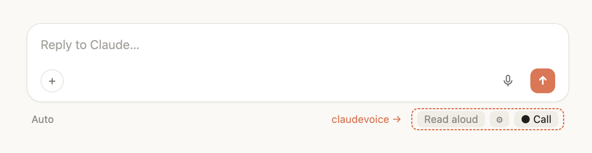
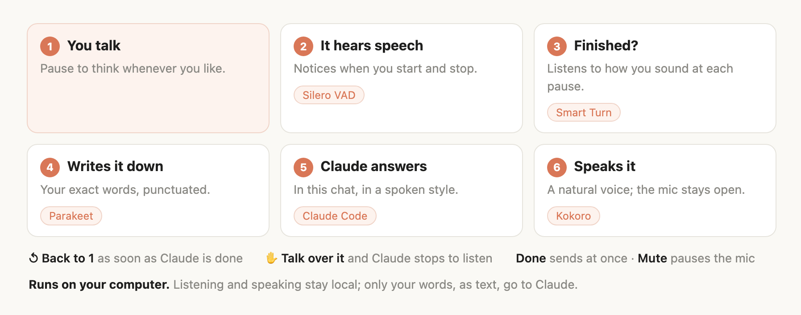
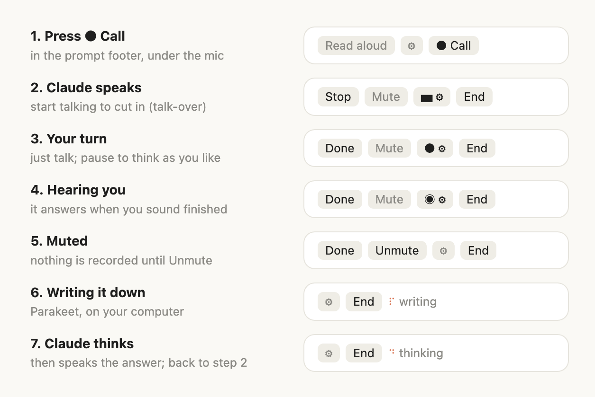
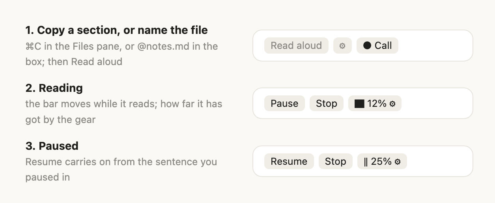
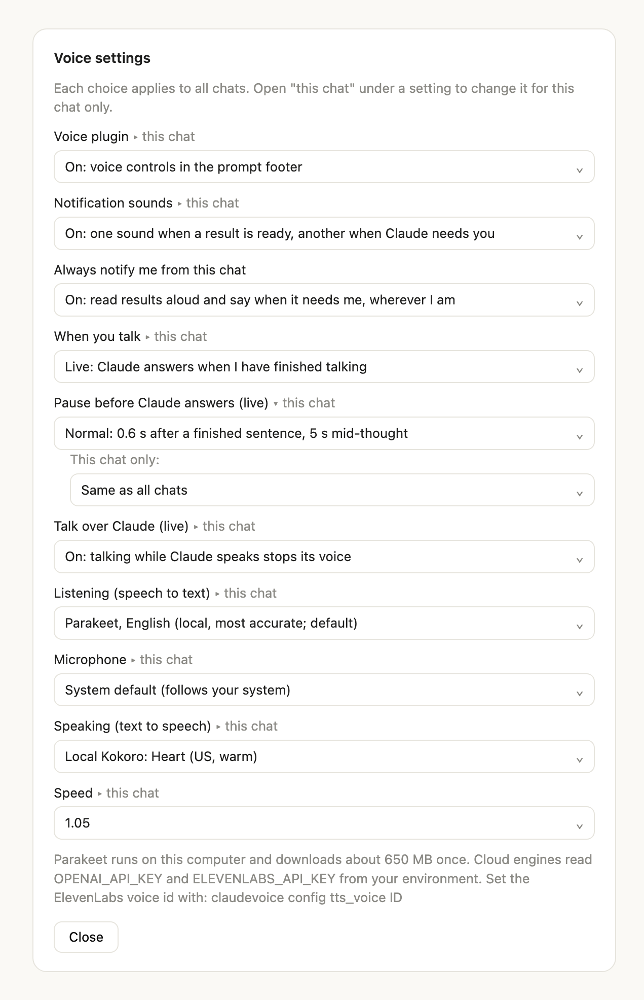

# claudevoice

[](https://github.com/SinaJaf/claudevoice/actions/workflows/tests.yml)

**Talk with Claude Code, and hear it talk back.** A live, hands-free voice conversation right inside
your Claude Code chat: you speak, Claude answers out loud when you've finished, and you can cut in
any time. It reads your files aloud too. It all runs on your computer.

<p align="center">
  
</p>

- **Just talk.** Pause to think as long as you like; Claude answers when you sound finished.
- **Cut in.** Start talking while Claude speaks, and it stops to listen.
- **Read files aloud.** Copy part of a markdown, text or PDF file, or name the file, and press
  **Read aloud**. Pause and pick up where you left off.
- **Many chats, no crossed wires.** Each chat has its own call and its own voice, and speaks only
  while you're in it. Sounds tell you when another chat is done or needs you.
- **Private and free.** Listening and speaking run on your computer, with no extra account or API key.
  Exactly what it downloads, runs and sends is [listed below](#what-it-downloads-runs-and-sends).

Works in the Claude Code desktop app and in the terminal, on macOS, Windows and Linux
([tested on each](#where-it-runs)).

## Get started

1. **Add the plugin.** In the Claude Code desktop app: **+** next to the prompt, **Plugins**,
   **Add marketplace** `SinaJaf/claudevoice`, then **Add plugin**. In a terminal session:
   `/plugin install claudevoice --marketplace SinaJaf/claudevoice`
2. **Press ● Call** under the prompt box and start talking. The first time, it sets itself up
   (it installs [uv](https://docs.astral.sh/uv/) if needed and downloads the voice): a few minutes,
   once, with pop-ups saying what it is doing. On Linux, install PortAudio first
   ([details](#install-in-detail)).

When a new version comes out, a pop-up says so, and **Update now** in the ⚙ settings installs it
([Updating](#updating)).

## How it works

<p align="center">
  
</p>

## A call, step by step

The controls sit on the right of the prompt footer and change with the call. Only the buttons you
can use right now are shown. The gear doubles as the live indicator: a moving bar while Claude
speaks, a dot while it listens (◉ once it hears you), and a word while it starts, writes down what
you said, or thinks.

<p align="center">
  
</p>

- **Done** sends what you said right away, without waiting for the pause.
- **Mute** pauses the mic. Nothing is recorded while muted, and what you already said is kept.
- **Stop** cuts Claude's voice. Talking over it does the same.
- **End call** (**End** in the desktop app, where the footer is narrow) stops the mic and the voice.
  It never cancels work Claude is doing.
- **Read aloud** (outside a call) speaks the last reply once, or a file ([below](#reading-files-aloud)).
- Switch headphones, speakers or microphones whenever you like: the voice and the mic follow your
  system's current devices, even mid-turn.

How it knows you've finished: [Smart Turn](https://github.com/pipecat-ai/smart-turn) listens to how
you speak, not only to silence. So "so what I want is..." or an "um" keeps the turn yours, while a
finished sentence ends it after a short pause. A long pause ends it anyway, and **Done** ends it at once.

## Reading files aloud

**Read aloud** reads what you point it at, in this order:

1. **Text you've just copied.** In any app (a PDF in Preview, a web page), highlight a section, copy
   it (⌘C, or Ctrl+C), and press **Read aloud**. A copied file path reads that file. Copying the
   same text again counts. Something copied out of the chat itself is left alone.
2. **Text you've highlighted.** In the chat, or, on a Mac, anywhere in the app, such as a file
   open in the Files pane: highlight a section and press **Read aloud**, no copying needed. On
   Windows and Linux, copy text in the Files pane first.
3. **A file named in the prompt box.** Type `@` and pick the file (`@notes.md`, `@report.pdf`),
   then press **Read aloud** to hear it from the start. `@notes.md#L40-80` reads just those lines.
   A path dragged into the box works too.
4. **The file open in the Files pane** (on a Mac): with nothing highlighted, **Read aloud** reads
   the whole file, from the start.
5. **Otherwise**, Claude's last reply.

<p align="center">
  
</p>

The app tells plugins only what you've highlighted in the chat. On a Mac, claudevoice reads a
highlight anywhere in the app, and which file the Files pane has open, through macOS Accessibility:
the permission the Claude app has under System Settings, Privacy & Security, Accessibility (it does
if you use computer use; if not, a one-time tip says where to turn it on). On Windows and Linux,
copy text in the Files pane, or name the file with `@`.

While a file is being read, **Pause** keeps your place, **Resume** carries on from the sentence you
paused in, and **Stop** ends it. The gear shows how far it has got. **Call** steps aside while a
file is being read, to keep the footer short; **Stop** brings it back. If Claude starts talking or
you start a call, the reading pauses instead of being lost.

You can also type `/read notes.md`, or `/read report.pdf 12` to start at page 12 (for a text file,
the number is a line).

Markdown, plain text and PDF work. Headings, lists and tables are read as sentences, code blocks
are announced rather than spelled out, and a PDF's page numbers, running headers and footers are
skipped. A scanned PDF (pictures of pages) has no text to read.

Text is cleaned up for listening. A section number is set apart from its title ("Eight", a pause,
"Reports and Analysis"), while a number in a sentence ("we have 8 reports") is read straight on.
Chapter VIII reads as "chapter eight", 0.5.1 as "0 point 5 point 1", Fig. 3 as "figure three", and
`notes.md` as "notes dot M D". On Apple Silicon you can choose the Qwen3-TTS voice for a more natural
reading; see [Voices](#voices).

## Voices

Choose a voice under **Speaking** in the ⚙ settings.

- **Kokoro** is the default. It runs on any computer and is light on memory and quick to make speech, but its tone is flat: a question mark or an exclamation mark barely changes how it sounds.
- **Qwen3-TTS** is more natural, with stops that follow the punctuation. It's offered on Apple Silicon Macs, and on Windows and Linux with an NVIDIA card from 2018 or later (GTX 16 or RTX series, 4 GB of graphics memory). Other computers aren't offered it, because a processor alone is too slow to read without stopping. It's heavy: 2 to 2.5 GB to download the first time you pick it, and about 4.5 GB of memory on a Mac while it's in use (it gives the memory back after five minutes unused, then takes a few seconds to load again). On a Mac with macOS 14 or newer there's also a lighter choice of engine for the same voice: about 1.3 GB to download and 2.5 GB of memory, and a little slower to make speech. Its two English voices, Aiden and Ryan, are both male, and **Speed** doesn't change its pace. It reads a few sentences at a time, so after **Pause**, **Resume** goes back to the start of that passage, up to about 20 seconds.
- **OpenAI and ElevenLabs** are cloud voices. They need an API key, cost money and send your text online.

## Several chats at once

Each chat runs on its own. Ending a call in one chat, pressing **Stop**, or a new reply never
touches another chat.

- **The mic goes to the chat you're in.** Leave a chat mid-call and its mic mutes, keeping what you
  already said; come back and it carries on. With two calls side by side on screen, the mic stays
  with the one you last used, and **Unmute** in the other brings it over.
- **A chat only speaks while you're in it.** Leave mid-sentence and it pauses; come back and it
  carries on from that sentence. A call's reply that finishes while you're away waits for you.
- **Voices never overlap.** One sentence plays at a time, and the chat you're in goes first.

Two settings in the **⚙** tell you what other chats are up to:

- **Notification sounds** (off until you turn them on): one sound when a result is ready, a
  different one when Claude needs you for a question, a plan or a permission. Turning them on plays
  both, so you know which is which. A reply that's being read to you needs no "ready" sound.
- **Always notify me from this chat** (set per chat): that chat reads its results aloud and says
  when it needs you, wherever you are in the app. From elsewhere it starts with the chat's project
  name ("From KLIZ…"), and waits its turn behind the chat you're in.

## What it downloads, runs and sends

Nothing leaves your computer unless you pick a cloud engine. There's no account and no telemetry.

**It downloads, once**, the first time you press **Call** or **Read aloud**:

- [uv](https://docs.astral.sh/uv/), if it isn't installed, with Astral's installer from astral.sh.
  uv may fetch a Python build of its own.
- The Python packages, from PyPI (about 900 MB; on Linux, PyTorch comes from download.pytorch.org),
  and spaCy's small English model from GitHub.
- The models, from Hugging Face: Kokoro (about 330 MB), Parakeet (about 650 MB), Smart Turn and
  Silero VAD (a few MB). Qwen3-TTS (2 to 2.5 GB) and Whisper only if you pick them.

**It checks** this repository's `plugin.json` on GitHub every few hours, to tell you about a new
version. Nothing is sent with that request.

**It runs on your computer:**

- A voice server that only answers on this computer (127.0.0.1, port 8765). It stays running so the
  voice starts quickly; `claudevoice stop-server` stops it, and it starts again when next needed.
- During a call, a listener that records your microphone, one turn at a time. Recordings stay in
  memory and are never saved (the Mac's own recognizer gets them through a temporary folder that is
  deleted straight after).
- Small helpers, only when you press **Read aloud**: `osascript` on a Mac (the clipboard, and,
  through Accessibility, what's highlighted in the Claude app and which file its Files pane has
  open), PowerShell on Windows, `wl-paste`, `xclip` or `xsel` on Linux. And `afplay`, PowerShell or
  `paplay` to play the notification sounds, if you turn them on.
- `uv sync` to install the Python side, and `claude plugin` commands when you press **Update now**.

**It sends:**

- What you say in a call goes to Claude as your message, exactly as if you'd typed it. During a
  call, Claude also gets a short note asking it to answer in a spoken style.
- Only if you pick them: the cloud voices send the text being read to OpenAI or ElevenLabs, and
  OpenAI's cloud transcription sends your recorded speech to OpenAI. The Mac's own recognizer stays
  on the device when the Mac supports that, and Windows' recognizer uses Microsoft's online speech
  service. Their own privacy policies apply.

**It keeps**, in `~/.claudevoice/`: your settings; logs, which name the files read aloud but hold
none of the text; and what you said in each turn, in a small hand-off file that the next call
clears out once it's a day old.
`last-read.json` records where the last **Read aloud** found its text and how long it was, never
the text itself. The packages live in the plugin's folder and the models in the Hugging Face cache.

---

## Settings



Open them with the **⚙** in the footer. Every choice applies to all chats; open **▸ this chat** under
a setting to choose a different value for the chat you're in, and **Same as all chats** to go back.

- **Voice plugin**: on, or off (off leaves only the gear, to turn it back on).
- **Notification sounds** and **Always notify me from this chat**: see
  [Several chats at once](#several-chats-at-once).
- **When you talk**: *Live* answers when you've finished; *Hold* waits for **Done**.
- **Pause before Claude answers**: Short, Normal, Long, then Long ×2 up to Long ×10 for long
  thinking pauses (Long ×10 waits 5 minutes of silence). A change applies even mid-turn.
- **Talk over Claude**: on with headphones; turn it off on speakers if Claude's own voice interrupts it.
- **Listening**: NVIDIA [Parakeet](https://huggingface.co/nvidia/parakeet-tdt-0.6b-v2) on your
  computer (default; English, or 25 European languages), the Mac's or Windows' own recognizer,
  Whisper (installed when you pick it), or OpenAI's cloud transcription.
- **Microphone**, **Speaking** ([local or cloud voices](#voices)) and **Speed**.

<br clear="right">

### The config file

The gear covers the common ones. Everything is in `~/.claudevoice/config.json`, also editable with
`uv run --project <plugin folder> python -m claudevoice config KEY VALUE`:

| key | default | meaning |
|-----|---------|---------|
| `voice` | `af_heart` | Kokoro voice, or a comma blend (`af_heart,af_bella`); see the model's VOICES.md |
| `lang_code` | `a` | `a` American, `b` British (Kokoro) |
| `speed` | `1.05` | playback pace |
| `stt_engine` | `auto` | `parakeet` (the `auto` default), `apple` (Mac), `windows` (Windows), `local` (Whisper), `openai` |
| `parakeet_model` | `v2` | `v2` English (most accurate for English), `v3` 25 European languages |
| `stt_language` | `` | language for the apple and windows engines (`en-US`, `fa-IR`...); empty follows the system |
| `whisper_model` | `large-v3-turbo` | `small`, `medium`, `large-v3-turbo`, `large-v3` |
| `input_device` | `` (system default) | microphone name; empty follows the system's input as it changes |
| `tts_engine` | `kokoro` | `kokoro`, `qwen` (Apple Silicon, recent NVIDIA card), `qwen_light` (Apple Silicon), `openai`, `elevenlabs` |
| `tts_voice`, `tts_model`, `tts_base_url`, `tts_api_key_env` | OpenAI defaults | cloud speech (ElevenLabs voice id goes in `tts_voice`) |
| `max_chars` | `2500` | longest reply read in full |
| `port` | `8765` | local server port |

## Install in detail

**1. uv** runs the plugin's Python side (it brings its own Python, nothing else to set up). The
plugin installs it the first time if it is missing, with Astral's own installer. To install it
yourself, on macOS and Linux:

```bash
curl -LsSf https://astral.sh/uv/install.sh | sh
```

Windows, in PowerShell:

```powershell
powershell -ExecutionPolicy ByPass -c "irm https://astral.sh/uv/install.ps1 | iex"
```

If it stops with "uv.exe ... is being used by another process", uv is already installed and in
use (the plugin runs it while the Claude app is open): skip this step. To update uv later, run
`uv self update`, or quit the Claude app and run the line above again.

On Linux, also install the audio library: `sudo apt install libportaudio2` (Debian, Ubuntu),
`sudo dnf install portaudio` (Fedora), `sudo pacman -S portaudio` (Arch).

**2. Add the plugin.** In the Claude Code desktop app: click **+** next to the prompt, **Plugins**,
**Add marketplace** with `SinaJaf/claudevoice`, then **Add plugin**. In a terminal session:

```
/plugin install claudevoice --marketplace SinaJaf/claudevoice
```

Open sessions pick it up with `/reload-plugins`; new sessions load it on their own.

**3. Press ● Call.** The first time, it sets itself up: the Python packages (~900 MB) and the models
(Kokoro ~330 MB, Parakeet ~650 MB, Smart Turn and Silero VAD a few MB). That takes a few minutes
once; pop-ups and the footer say what it is doing. Your system asks for microphone access the
first time. Everything lives under the plugin folder, `~/.claudevoice/` and the Hugging Face cache.

Nothing else is needed: no espeak-ng (it ships inside the packages), no Xcode tools, no GPU drivers.

## Updating

Claude Code doesn't update plugins from GitHub on its own (auto-update is off for marketplaces
like this one). So the plugin checks for a newer version every few hours. When there is one, a
pop-up says so, and the ⚙ settings show **Update now**: press it, then type `/reload-plugins`.
The first use after an update replaces the voice server with the new version's.

By hand, in a terminal:

```
claude plugin marketplace update claudevoice
claude plugin update claudevoice@claudevoice
```

then `/reload-plugins` in the app. To let Claude Code update it by itself: in a terminal session,
`/plugin`, **Marketplaces**, **claudevoice**, **Enable auto-update**.

## Where it runs

Everything runs on the processor (CPU), so any graphics card (NVIDIA, AMD, Intel, Apple) or none
works the same. Every package installs from a ready-made build; nothing is compiled on your machine.

| system | chips | needs | status |
|--------|-------|-------|--------|
| macOS 14 Sonoma or newer | Apple Silicon (M1 and later) | uv | used daily; passes every test on GitHub |
| macOS 13 or newer | Intel | uv | passes every test on GitHub (macOS 15); PyTorch 2.2, the last for Intel Macs |
| Windows 10 / 11 | Intel or AMD (x64) | uv | used on a laptop, Qwen3-TTS on NVIDIA too; passes every test on GitHub |
| Windows 11 | ARM (Snapdragon) | uv | passes every test on GitHub |
| Linux, glibc 2.28+ (Ubuntu 20.04+, Debian 10+, Fedora, Arch) | Intel or AMD (x64) | uv, PortAudio | passes every test on GitHub (Ubuntu 24.04); CPU-only PyTorch, ~200 MB instead of ~2.5 GB |
| Linux, as above | ARM64 | uv, PortAudio | passes every test on GitHub (Ubuntu 24.04) |

"Passes every test on GitHub" means a clean install, all the tests, and Kokoro speaking a sentence
that Parakeet hears back word for word, on every push
([latest results](https://github.com/SinaJaf/claudevoice/actions/workflows/tests.yml)). The test
machines have no speakers or microphone, so sound devices are the one part they can't check: if
yours aren't found, **Copy setup report** in the settings shows what the plugin sees.

Memory: about 1.5 GB during a call, up to about 2.5 GB while writing down an hour-long turn.
Speed on an Apple M-series laptop: a minute of speech is written down in about a second.

## Long talks

One turn can run up to an hour; at an hour it is sent and the mic keeps listening for the next.
Long pauses are squeezed out before writing it down, and long turns are written down in pieces cut
at quiet moments. Tested: a one-hour talk with pauses came back as 4,861 of 4,861 words with two small
errors (0.04%), written down in 24 seconds.

## Under the hood

```
Claude Code (any surface)
  prompt footer controls  ──$.http──▶  claudevoice server (Kokoro, warm, 127.0.0.1:8765)
  ● Call: mic ─▶ VAD + Smart Turn ─▶ Parakeet ─▶ prompt ─▶ reply ─▶ speak   └─ speakers
          (the mic stays open while Claude speaks: talking over it stops the voice)
  Read aloud: copied text, chat selection, @file or last reply ─▶ /read, sentence by sentence
```

- `hooks/register.tsx` is the Claude Code plugin: the footer controls, the settings dialog, Read
  aloud (what you copied, what you highlighted, a file named in the box, or the last reply), the
  call loop (a detached listener per turn, `$.prompt.submit`, `turn.complete`), and a spoken-style
  note Claude receives during calls. It also routes the app's built-in speech calls through the chosen speaking engine.
- `claudevoice/` is the Python side, run through the project's `uv` environment:
  `tts_server.py` keeps Kokoro loaded and plays audio, following the system's output device;
  `document.py` turns a file or a selection into text to read (PDFs through PDFium: lines
  joined back into paragraphs, broken words mended, headers and page numbers dropped), and the
  server reads it sentence by sentence, keeping its place for Pause and Resume; `clean.py` turns
  markdown into speakable text (code fences become "python code block, 12 lines", paths collapse
  to file names, `app.py:42` reads as "app.py line 42"). `pacing.py` adds pauses for Kokoro, which
  leaves few at punctuation but says when each word falls. Speech is made a few pieces ahead of
  what is playing, by a thread of its own, so a stop between sentences isn't also the time it took
  to make the next one. Qwen3-TTS (`qwen.py`: mlx-audio or qwentts.cpp on Metal on a Mac, qwentts.cpp with CUDA elsewhere) streams, so it starts sounding quickly.
- Chats stay apart in three places. A window showing a chat attaches to it, so a chat with no
  surface (`$.session.surfaces()`, `session.attach` and `session.detach`) is one you're not in.
  Each chat's listener talks to it through its own folder, `~/.claudevoice/chats/<id>/`. And every
  request to the voice server names its chat: the server keeps each chat's speech and place apart
  and plays one sentence at a time, the chat on screen first.
- `listen.py` runs one turn and transcribes it. `live.py` is live mode: Silero VAD hears speech,
  Smart Turn (`turn.py`, its Whisper features computed in numpy) judges each pause, and talking
  while the voice server is speaking stops it. `record.py` follows the system's input device.
  `apple/selection.js` (run with `osascript`, nothing to build) reads the clipboard, what is
  highlighted in the Claude app, and the file its Files pane has open, on a Mac. `stt.py` picks the engine: Parakeet through onnx-asr (int8, CPU), `apple/ClaudeVoiceSTT.swift`, a tiny signed
  helper app running the Mac's on-device recognizer (macOS grants speech recognition only to an
  app that declares it), `windows/dictate.ps1` driving Windows' recognizer from the built-in
  Windows PowerShell (it listens to the default mic itself, phrase by phrase, until Done), Whisper (mlx-whisper on Apple Silicon, faster-whisper elsewhere), or a
  cloud endpoint.
- Cloud voices are OpenAI-compatible endpoints (OpenAI, Groq, a local server) and ElevenLabs. Keys
  are read from `OPENAI_API_KEY` / `ELEVENLABS_API_KEY` in your environment or login shell; nothing
  secret is written to disk. If a cloud voice can't be used, Kokoro says why and reads the reply.

## Extras (macOS and Linux)

`./install.sh` front-loads the downloads and installs a `claudevoice` command:

- `claudevoice chat`: a terminal speech-to-speech loop around `claude -p` (your listening engine →
  Claude → Kokoro, streamed sentence by sentence; needs the `claude` CLI logged in).
- `claudevoice say "text" [--voice bm_george]`, `claudevoice voices`, `claudevoice stop-server`.
- `CLAUDEVOICE_ALWAYS_ON_HOOKS=1 ./install.sh` registers optional Stop/UserPromptSubmit hooks
  that read *every* reply aloud; `claudevoice on` / `off` toggles them.

## Development

```bash
claude plugin validate .      # manifest + hooks module
claude plugin test .          # tests/panel.test.tsx against the engine
.venv/bin/python -m unittest tests.test_report tests.test_qwen tests.test_reading tests.test_speaker
.venv/bin/python -m claudevoice self-test         # Kokoro speaks, Parakeet must hear the same words
```

Every push runs the same on GitHub ([`.github/workflows/tests.yml`](.github/workflows/tests.yml)):
a clean install, the tests and the self-test on macOS (Apple Silicon and Intel), Windows (x64 and
Arm) and Linux (x64 and Arm).

Edits reach a running session with `/reload-plugins` when the plugin was installed from this folder
(`claude plugin marketplace add <folder>` then `claude plugin install claudevoice@claudevoice`).

## Troubleshooting

Something not working? Two things help most:

- **Copy setup report**, at the bottom of the ⚙ voice settings, puts a short report on your
  clipboard: your system, what is installed, which voice files are downloaded, the sound devices
  it sees and the last errors in the logs. It holds no text that was read aloud, no transcripts
  and no file names. Paste it into a [bug report](https://github.com/SinaJaf/claudevoice/issues/new/choose).
  If the plugin won't start at all, run `uv run python -m claudevoice report` from the plugin's folder.
- **The self-test**, `uv run python -m claudevoice self-test` from the plugin's folder, has Kokoro
  speak a sentence and Parakeet write down what it hears. It needs no speakers or microphone, so it
  separates "the voice is broken" from "the sound devices are".

Other things to check:

- Logs: `~/.claudevoice/server.log` (speech) and `~/.claudevoice/claudevoice.log` (hooks).
- **Read aloud** read something other than you meant: it reads anything copied since you last
  pressed it, then text still highlighted (in the Files pane too). Press **Stop**, click away from
  the highlight, and press **Read aloud** again. `~/.claudevoice/last-read.json` says what the last
  press found (where it came from and how long it was, never the text).
- The footer ends in "…": the app gives it a fixed width and cuts what doesn't fit. Hover over it
  to see the whole row, or widen the window.
- "speech recognition is not allowed": turn on **Claude Voice transcription** in System Settings,
  Privacy & Security, Speech Recognition.
- Windows: a black `python.exe` window stays open, and closing it stops the voice (0.4.2 and
  earlier). [Update](#updating) the plugin: the new version replaces that server by itself.
- Windows: "turn on Online speech recognition": Windows Settings, Privacy & security, Speech. The
  windows engine uses the default microphone (Settings, System, Sound, Input); pick Whisper in the
  gear to choose a specific one.
- "The microphone is giving silence": the input carries no signal (lid closed, unplugged, or no
  microphone permission). Pick another microphone in the gear.
- Silent after picking a cloud voice: the key isn't visible to the server. Export it in your shell
  profile and run `claudevoice stop-server` (it restarts on the next use).
- The plugin runs the Python side with `uv`; GUI apps start with a short PATH, so it looks in
  `~/.local/bin`, `/opt/homebrew/bin`, `/usr/local/bin` and `~/.cargo/bin` too.

## License

MIT, the notification sounds included (`scripts/make_sounds.py` generates them). The models it
downloads keep their own licenses: Kokoro-82M (Apache-2.0, hexgrad), Qwen3-TTS (Apache-2.0, Alibaba
Qwen; MLX conversion by mlx-community, run with mlx-audio; GGUF conversion by Serveurperso, run with
qwentts.cpp through realtimetts-qwen-native, both MIT),
Parakeet TDT 0.6B v2 and v3 (CC-BY-4.0, NVIDIA; ONNX export by istupakov, run with onnx-asr),
Smart Turn v3.2 (BSD-2-Clause, Daily / Pipecat) and Silero VAD (MIT, Silero Team). PDFs are read
with pypdfium2 (Apache-2.0 or BSD-3-Clause) and PDFium (BSD-3-Clause).
